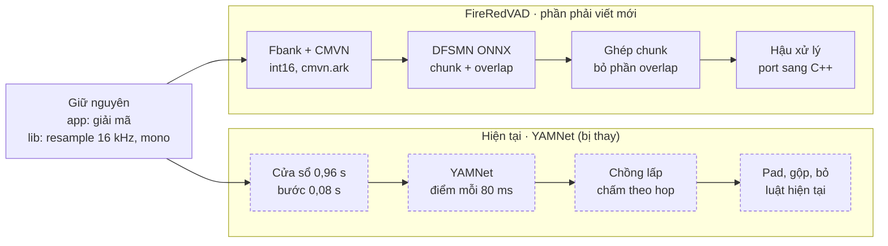

# FireRedVAD – Technical Limitations & Integration Constraints

Oct 15, 2026 · @jose

## Phạm vi

FireRedVAD bản non-streaming tích hợp được vào lib.so hiện tại, nhưng phải thay toàn bộ phần tiền xử lý và tự viết lại hậu xử lý bằng C++. Tài liệu này liệt kê các giới hạn đã kiểm chứng trên mã nguồn, file model và lần chạy thử trên `hello_zh.wav`.

- **Đối tượng:** model `fireredvad_vad.onnx` (non-streaming VAD) + `cmvn.ark`, repo FireRedTeam/FireRedVAD, bản tải về ngày 2026-10-12.
- **Đích tích hợp:** lib.so Android hiện tại, xử lý cả file (không streaming), audio đã được app giải mã trước khi vào lib.
- **Không bao gồm:** Stream-VAD và AED, chỉ nhắc khi liên quan.
- Các con số về chất lượng lấy từ báo cáo của tác giả, chưa đo trên dữ liệu của bạn.

## Tóm tắt

Bảy ràng buộc dưới đây quyết định việc tích hợp có đúng hay không; phần lớn sai sót sẽ không báo lỗi mà chỉ làm xác suất sai.

| Ràng buộc | Giá trị bắt buộc | Hậu quả nếu sai |
| --- | --- | --- |
| Sample rate, kênh | 16 kHz, mono | Fbank sai dải tần, model đoán sai |
| Thang biên độ | int16 (−32768…32767), không chuẩn hoá về ±1 | Mọi giá trị log lệch \~20,8, xác suất sai |
| Fbank | 80 mel, 25/10 ms, Povey, pre-emph 0.97, bỏ DC, dither 0, 20–8000 Hz | Xác suất lệch, khó phát hiện |
| CMVN | `(x − mean) / std` từ `cmvn.ark`, 80 cặp số cố định | Model nhận đầu vào ngoài phân bố huấn luyện |
| Tensor vào / ra | `feat` \[1, T, 80\] float32 → `probs` \[1, T, 1\] | — |
| Tầm nhìn của model | khung t−152 … t+160 (\~1,5 s trước, 1,6 s sau) | Cắt chunk không overlap làm sai \~1,6 s quanh mỗi chỗ cắt |
| Hậu xử lý | Không có sẵn trong C++, phải tự port | Runtime NCNN mẫu chỉ so ngưỡng 0.5 từng khung |

## Đầu vào audio

Model chỉ nhận PCM 16 kHz, mono, giá trị ở thang int16. Code gốc kiểm tra `sample_rate == 16000` và mảng 1 chiều, ngoài ra không kiểm tra gì.

- **Thang biên độ:** Fbank được tính trên số nguyên −32768…32767 (đọc bằng `dtype="int16"`). Nếu lib giữ audio dạng float ±1 như đầu vào YAMNet, phải nhân 32768 trước khi tính Fbank.
- **Resample và downmix:** vẫn làm trong lib như hiện tại. Chất lượng bộ resample ảnh hưởng tới dải cao gần 8 kHz; chưa đo mức ảnh hưởng.
- **Cắt khung:** khung 400 mẫu (25 ms), bước 160 mẫu (10 ms), `snip_edges = true`. Số khung `T = 1 + (N − 400) // 160`; phần đuôi dưới 10 ms bị bỏ.
- **Độ dài tối thiểu:** audio ngắn hơn 400 mẫu (25 ms) cho 0 khung; lib phải trả về rỗng thay vì gọi model. File dưới 200 ms không thể có đoạn nào với `min_speech_frame = 20`.
- **File dài:** đầu ra Fbank là T × 80 float, khoảng 32 KB mỗi giây audio; 1 giờ audio ≈ 115 MB nếu giữ cả mảng. Nên tính Fbank theo chunk (xem phần Model & runtime).

## Tiền xử lý: Fbank và CMVN

Fbank và CMVN nằm ngoài file ONNX, nên lib phải tính lại đúng từng tham số. Bản Python dùng `kaldi_native_fbank`; repo có sẵn bản C++ trong `runtime/common/frontend/fbank.h` (kèm `fft.cc`), dùng được cho NDK.

| Tham số | Giá trị |
| --- | --- |
| Số dải mel | 80 |
| Khung / bước | 25 ms / 10 ms (400 / 160 mẫu) |
| Bỏ DC | có |
| Pre-emphasis | 0.97 |
| Cửa sổ | Povey: `(0.5 − 0.5·cos(2πn/399))^0.85` |
| FFT | 512 điểm, phổ công suất |
| Dải tần mel | 20 Hz – 8000 Hz, thang `1127·ln(1 + f/700)` |
| Log | log tự nhiên, kẹp dưới bởi epsilon float32 |
| Dither | 0 (kết quả tất định) |

- **CMVN:** `cmvn.ark` là ma trận Kaldi nhị phân 2 × 81 (double). `mean = hàng1 / count`, `var = hàng2 / count − mean²`, kẹp dưới 1e−20. Giá trị thật: mean 10,4–16,1, std khoảng 4,0–4,6. Script export NCNN tách sẵn thành `cmvn_means_vad.bin` và `cmvn_istd_vad.bin`.
- **Mỗi model một file CMVN:** VAD, Stream-VAD và AED có file riêng; dùng nhầm file sẽ không báo lỗi.
- **Kiểm chứng:** bản numpy tự viết theo bảng trên cho đoạn (0.44, 1.82) trên `hello_zh.wav`, khớp kết quả chính thức. Chưa so sánh từng giá trị Fbank với bản C++.

## Model và runtime

Model nhỏ và chỉ dùng op phổ biến, nên chạy được cả ONNX Runtime lẫn NCNN; ràng buộc chính nằm ở bộ nhớ với file dài và chỗ cắt chunk.

| Mục | Giá trị |
| --- | --- |
| Tham số | 588.417 (\~2,2 MB float32) |
| Đầu vào | `feat` float32 \[batch, time, 80\], `time` động |
| Đầu ra | `probs` float32 \[batch, time, 1\], sau sigmoid |
| Opset khi export | 11 |
| Op trong graph | MatMul, Add, Relu, Transpose, Conv (depthwise, group 128, kernel 20), Slice, Pad, Sigmoid |
| Khối lượng tính (ước tính) | \~0,59 triệu MAC mỗi khung, \~59 triệu MAC mỗi giây audio |
| Độ chính xác số | chỉ có float32; chưa có bản int8/fp16 |

- **Tầm nhìn hai chiều:** mỗi lớp FSMN nhìn khung t−19 … t+20; 8 lớp cộng dồn thành t−152 … t+160. Model cần thấy \~1,6 s audio phía sau mới cho xác suất đầy đủ ngữ cảnh.
- **Biên file:** ngoài file được đệm 0, nên \~1,6 s đầu và cuối mỗi file có ít ngữ cảnh hơn phần giữa.
- **Cắt chunk:** `vad.py` cắt file dài hơn `chunk_max_frame = 30000` (300 s) thành các đoạn liền nhau, không overlap. Mỗi chỗ cắt gây hiệu ứng biên như trên. Nên cắt có overlap ≥ 160 khung mỗi bên và bỏ phần overlap khi ghép.
- **Bộ nhớ:** một tensor trung gian rộng 256 chiếm T × 1 KB; chunk 30000 khung ≈ 31 MB cho mỗi tensor như vậy. Trên điện thoại nên dùng chunk nhỏ hơn nhiều (ví dụ 30–60 s có overlap).
- **NCNN trong repo:** script `build_android.sh` mặc định build `armeabi-v7a` (32-bit), API 21; cần đặt `ABI=arm64-v8a`. C API có sẵn chỉ dành cho Stream-VAD; bản non-streaming chỉ có chương trình mẫu `test_vad_non_stream.cpp`, phải tự viết wrapper.
- **ONNX Runtime:** dùng được file `fireredvad_vad.onnx` trực tiếp; đã chạy trên onnxruntime 1.29 (desktop), chưa chạy trên thiết bị Android.
- **Stream-VAD:** là file model khác (567.937 tham số, không nhìn tương lai), cần cache `[8, 1, 128, 19]` giữa các lần gọi. Không cần cho pipeline xử lý cả file.

## Chất lượng và định nghĩa nhãn

Con số công bố được đo trên giọng đọc khá sạch, còn định nghĩa "voice" của FireRedVAD chỉ khớp một phần với quy ước gán nhãn của bạn.

- **Benchmark của tác giả:** FLEURS-VAD-102, 9.443 file giọng đọc thuộc 102 ngôn ngữ. AUC 99,60%, F1 97,57%, FAR 2,69%, miss rate 3,62%, đo theo khung 10 ms ở ngưỡng 0.5. Bộ test chưa được công bố nên chưa tự kiểm lại được.
- **Ngưỡng mặc định khác ngưỡng benchmark:** config mặc định dùng `speech_threshold = 0.4`, báo cáo dùng 0.5.
- **Dữ liệu huấn luyện:** "hàng nghìn giờ" nhãn do người gán, không công bố tỉ lệ ngôn ngữ, thể loại nhạc hay môi trường thu.
- **Định nghĩa của FireRedVAD:** voice = speech + singing; non-voice = music, silence, noise. Các loại âm khác không được nêu rõ.

| Loại âm | Nhãn của bạn | FireRedVAD | Rủi ro |
| --- | --- | --- | --- |
| Hát, đọc thơ, rap | speech | voice | Khớp |
| Nhạc không lời | non-speech | non-voice (music) | Khớp |
| Hô có lời | speech | voice | Khớp |
| Ngân nga (humming), hát bè, hợp xướng | speech | Không nêu rõ | Cần đo |
| Đám đông ồn ào không nghe rõ | non-speech | Không nêu rõ | Có thể báo nhầm là voice |
| Giọng nhỏ chìm sau nhạc | non-speech | Không nêu rõ | Có thể báo nhầm là voice |
| Cười, ho, hắt hơi, khóc không lời | non-speech | Không nêu rõ | Cần đo |

- **Không có code huấn luyện:** chỉ có trọng số và code suy luận, không có code huấn luyện. Muốn đổi hành vi cho các dòng "Cần đo" chỉ có thể chỉnh ngưỡng và hậu xử lý, hoặc tự viết pipeline fine-tune.

## Hậu xử lý và đầu ra

Hậu xử lý của FireRedVAD đã tự nới đầu và cuối đoạn, nên ghép thêm padding 100/120 ms hiện tại sẽ bị nới hai lần. Mọi tham số tính bằng khung 10 ms.

Thứ tự trong `vad_postprocessor.py`: làm mượt → so ngưỡng → máy trạng thái → bù trễ làm mượt → gộp khoảng lặng → nới đoạn → cắt đoạn dài.

| Quy tắc trong lib hiện tại | Tham số FireRedVAD gần nhất | Khác biệt |
| --- | --- | --- |
| Pad 100 ms trước, 120 ms sau | `extend_speech_frame` (mặc định 0) | Chỉ nới đối xứng hai bên; pad lệch phải tự viết |
| Gộp khoảng lặng < 500 ms | `merge_silence_frame = 50` hoặc `min_silence_frame = 50` | `min_silence_frame` nằm trong máy trạng thái và đồng thời kéo dài cuối đoạn |
| Bỏ đoạn < 0,32 s | `min_speech_frame = 32` | Xét chuỗi khung vượt ngưỡng liên tiếp trước khi gộp, không phải đoạn cuối cùng |
| (không có) | `max_speech_frame = 2000` | Cắt đoạn > 20 s tại khung có xác suất thấp nhất |

- **Padding ngầm:** máy trạng thái coi các khung đang chờ trong `POSSIBLE_SILENCE` là giọng, nên cuối mỗi đoạn dài thêm `min_silence_frame` khung (mặc định 200 ms). Bước bù trễ lùi đầu đoạn `smooth_window_size` khung (mặc định 50 ms). Trên `hello_zh.wav`, khung vượt ngưỡng là 49–161, đoạn cuối là 44–182.
- **Làm mượt một chiều:** trung bình trượt chỉ dùng khung t−(W−1) … t, gây trễ \~W/2 khung trước khi được bù ở đầu đoạn.
- **Đầu ra:** danh sách `(start, end)` tính bằng giây, bước 10 ms. Đoạn chạm cuối file kết thúc tại `min(T × 0.01 + 0.025, thời lượng file)`. Model cũng trả mảng xác suất T phần tử, dùng được cho AUC.
- **So với ground truth 0,5 s:** 50 khung gộp thành một ô. Cách gộp xác suất (trung bình, max, hay tỉ lệ khung vượt ngưỡng) làm thay đổi AUC; phải chọn một cách và dùng chung cho mọi model trong vad-compare.

## Tích hợp vào lib.so hiện tại

Giải mã và resample giữ nguyên; bốn bước sau đó phải thay, và cả bốn đều cần code C++ mới.

*Pipeline lib.so: hiện tại và sau khi đổi sang FireRedVAD. Cả hai nhánh trả về danh sách đoạn (giây).*

Bước "chồng lấp" của YAMNet không còn cần, nhưng bước ghép chunk thay vào vì model cần \~1,6 s ngữ cảnh mỗi bên.

1. **Thang biên độ:** giữ PCM int16 cho FireRedVAD; YAMNet nhận float ±1, nên nếu lib chuyển sang float thì nhân lại 32768.
2. **Fbank + CMVN:** dùng `fbank.h` và `fft.cc` từ `runtime/common/frontend`, nạp `cmvn_means_vad.bin` và `cmvn_istd_vad.bin`.
3. **Model:** chọn ONNX Runtime với `fireredvad_vad.onnx`, hoặc NCNN build `arm64-v8a` kèm wrapper non-streaming tự viết.
4. **Ghép chunk:** chia file thành chunk có overlap ≥ 160 khung mỗi bên, chỉ giữ phần giữa của mỗi chunk.
5. **Hậu xử lý:** port `vad_postprocessor.py` (247 dòng) sang C++, hoặc giữ luật hiện tại tính theo khung 10 ms. Chọn một trong hai; dùng cả hai sẽ nới đoạn hai lần.
6. **API của lib:** vẫn trả `(start, end)` theo giây nên phía app không đổi; độ phân giải tăng từ 80 ms lên 10 ms.
7. **Kích thước gói:** file ONNX 2,39 MB cộng thư viện runtime; dung lượng runtime trên APK chưa đo.

Giấy phép: repo và model dùng Apache-2.0, cho phép dùng trong app thương mại nếu giữ thông báo bản quyền và văn bản giấy phép.

## Rủi ro mở và việc cần kiểm chứng

Chưa có số đo nào trên thiết bị Android hay trên dữ liệu của bạn; tám việc dưới đây cần xong trước khi quyết định thay YAMNet.

- [ ] Đo RTF, CPU và bộ nhớ đỉnh trên máy Samsung mục tiêu (arm64), so ONNX Runtime với NCNN.
- [ ] So từng giá trị Fbank của `runtime/common/frontend/fbank.h` với `kaldi_native_fbank` trên vài file mẫu.
- [ ] Chạy vad-compare theo từng category, tách riêng đám đông, giọng chìm, tiếng cười/ho và ngân nga để đo mức lệch nhãn.
- [ ] Chọn ngưỡng bằng ROC trên dữ liệu của bạn (mặc định 0.4; ngưỡng Youden của YAMNet hiện là 0.6026).
- [ ] Chọn độ dài chunk và overlap; kiểm tra kết quả khớp với chạy cả file.
- [ ] Chọn cách gộp xác suất 10 ms thành ô 0,5 s và áp dụng chung cho mọi model.
- [ ] Kiểm tra ảnh hưởng của bộ resample trong lib lên xác suất (so với resample bằng ffmpeg).
- [ ] Giữ văn bản giấy phép Apache-2.0 trong phần thông tin mã nguồn mở của app; ghi rõ nếu đã sửa code hoặc model.
